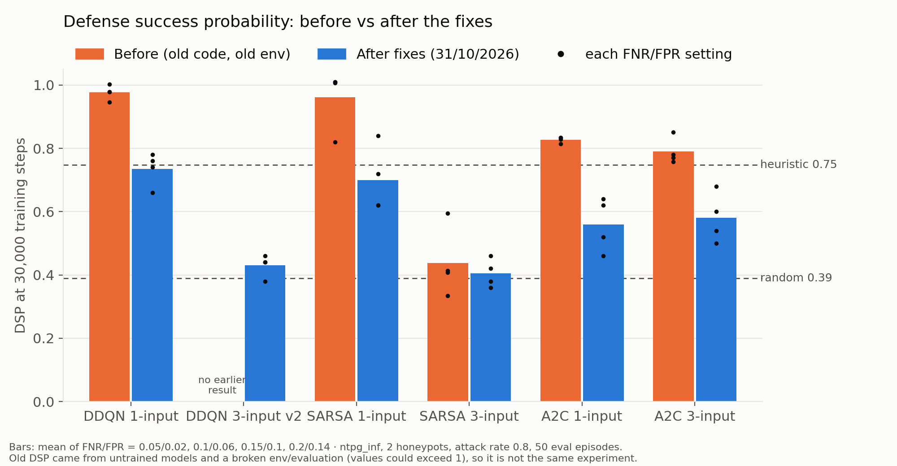
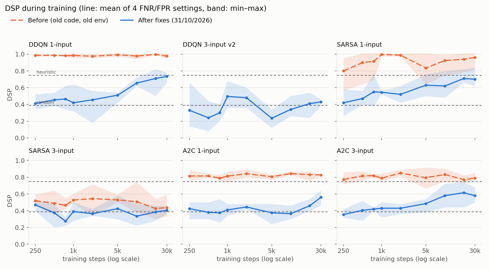
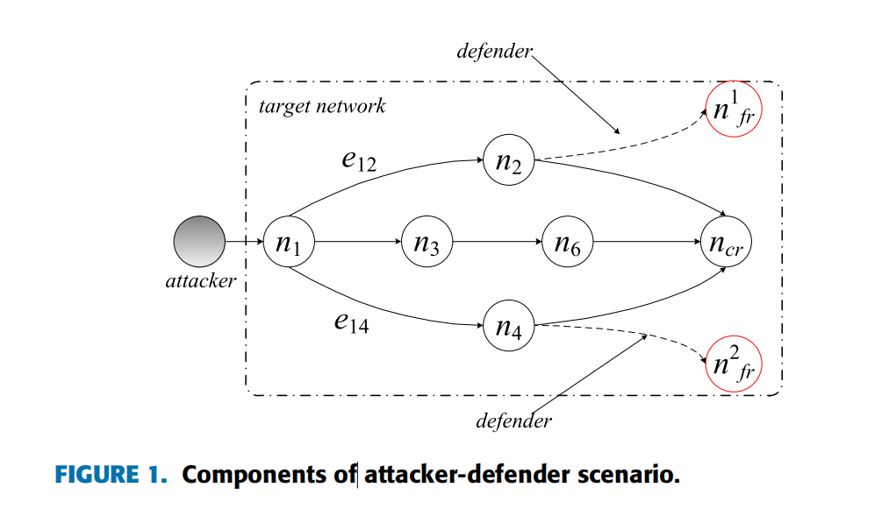
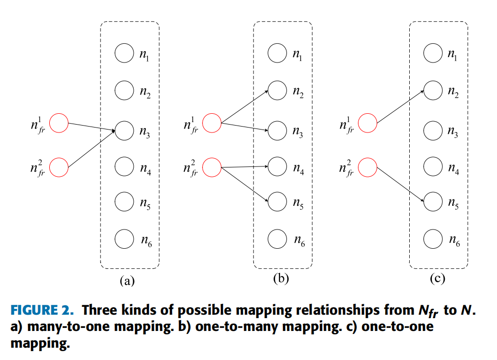
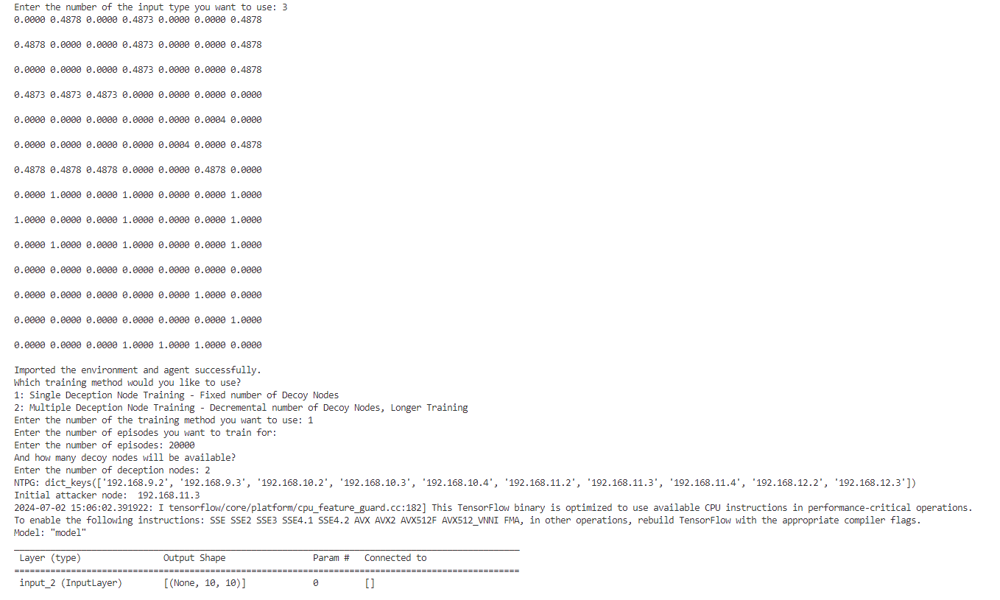
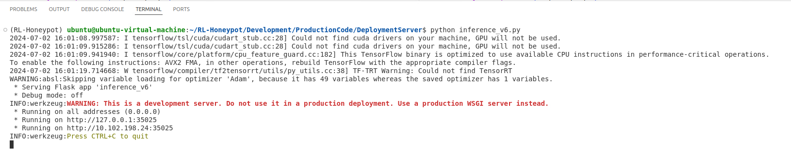
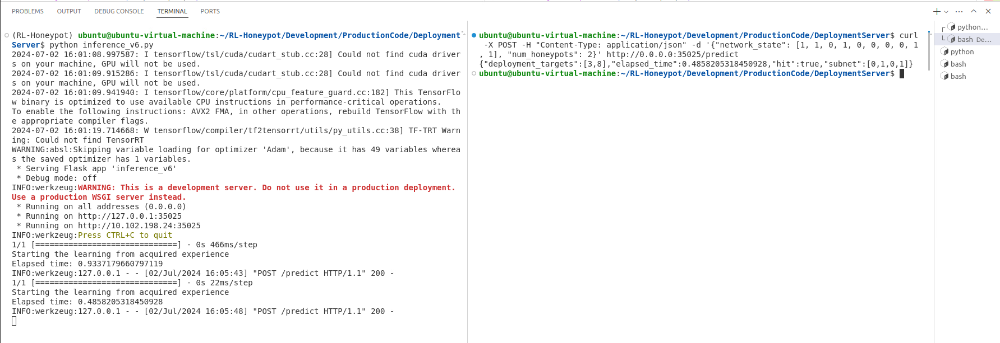

Em xin hướng dẫn thầy phương pháp chạy code huấn luyện và suy luận của model

# CẬP NHẬT 31/10/2026: SỬA LỖI VÀ HUẤN LUYỆN LẠI (Claude, Anthropic)

*Phần này do **Claude** (mô hình AI của Anthropic) viết, ngày 31/10/2026. Chi tiết từng thay đổi (tiếng Anh) nằm trong [FIXES.md](FIXES.md). Mọi dòng code đã sửa đều có comment `# FIX:`, tìm nhanh bằng lệnh `git grep -n "# FIX:"`.*

## Tóm tắt

Kết quả FNR/FPR trước đây không phản ánh đúng chất lượng model, vì các lý do sau:

- Không model nào thực sự được huấn luyện.
- Môi trường cho agent thấy trạng thái thật thay vì trạng thái qua IDS.
- Phần đánh giá đo sai cách.

Sau khi sửa, cả 6 model đã được huấn luyện lại từ đầu (24 lần chạy, mỗi lần 30.000 step). Các model 1 input (DDQN, SARSA) giờ đặt honeypot tốt gần bằng một luật heuristic viết tay. Các model 3 input của DDQN/SARSA vẫn chưa học được gì đáng kể sau 30.000 step.

## Các lỗi đã sửa

### Đợt 1: vòng lặp huấn luyện, môi trường, đánh giá

1. **Không model nào được huấn luyện (lỗi quan trọng nhất).** Trong `trainingSingleEpisodes()` của mọi agent, các lệnh `if terminalState: break` / `if not terminalState: continue` thoát vòng lặp trước khi lưu transition vào replay buffer và gọi `trainNetwork()`. Vì vậy mọi checkpoint đã lưu đều là mạng chưa học.
2. **FNR/FPR không ảnh hưởng tới thứ agent thấy.** Môi trường trả về trạng thái thật (`_state`) làm observation. Giờ observation là `_alerted_state`, tức góc nhìn của IDS có nhiễu FNR/FPR, và trạng thái này được xóa sau mỗi lần `reset()`.
3. **Lệch chỉ số node.** Action dùng ID node bắt đầu từ 1, còn các kiểm tra `_state[i]` lại bắt đầu từ 0. Node quan trọng (critical node) bị gán cứng trong `reset()`. Giờ mọi chỗ dùng ID từ 1, và node quan trọng mặc định là node 6, chính là node mà các lần chạy cũ thực sự dùng.
4. **Thứ tự trong một step.** Code cũ kiểm tra bắt được attacker *trước* khi đặt honeypot mới và cho attacker di chuyển, nên reward đến trễ một step. Giờ thứ tự là: đặt honeypot → attacker di chuyển → kiểm tra → reward. Chỉ tính là bắt được khi attacker *vừa bước vào* node honeypot.
5. **`trainNetwork()` của DDQN** ghi Q-target vào sai vị trí (dùng tuple node làm chỉ số). Code cũ cũng chạy `epochs=200` trên mỗi minibatch, nên rất chậm và overfit; giờ là 1 epoch.
6. **A2C:** viết lại `trainNetwork()` thành bản cập nhật actor-critic một bước đúng nghĩa.
7. **SARSA:** bỏ dòng `reward += 1`, vì nó biến reward thắng (1) thành 2 nên không bao giờ đếm được lần thắng.
8. **Đánh giá (`evaluation_headless_v2.py`):**
   - Code cũ dùng môi trường A2C_Subnet sinh mạng ngẫu nhiên mỗi episode, với FNR/FPR gán cứng.
   - Mỗi episode bị chạy 2 lần nhưng vẫn chia cho 50, và lấy trung bình các giá trị cộng dồn. Đó là lý do DSP có thể lên tới 1.01.
   - Giờ đánh giá dùng đúng môi trường và tham số lúc huấn luyện, và DSP = số lần thắng / số episode.
9. **Driver (`driver_v2.py`):** sửa đường dẫn lưu file kết quả (thiếu dấu `/`). Thêm tham số dòng lệnh để chạy không cần nhập tay (xem bên dưới).

### Đợt 2: sau lần huấn luyện đầy đủ đầu tiên

Lần chạy đầu tiên sau đợt 1 cho DSP chỉ 0.36–0.52, *thấp hơn cả đặt honeypot ngẫu nhiên*, và tiến trình ngốn tới 24.7 GB RAM. Nguyên nhân và cách sửa:

1. **Lớp đầu ra của Q-network dùng `softmax`.** Softmax ép Q-value về 0..1 và tổng bằng 1, nên không thể biểu diễn reward −1 khi thua. Đã đổi sang `linear` cho 5 agent DDQN và SARSA 3 input. Actor của A2C vẫn giữ softmax vì đó là phân phối xác suất của policy, dùng softmax là đúng.
2. **Rò rỉ bộ nhớ.**
   - Loss của DDQN đọc một list toàn cục `actionsAppend`, list này tăng 100 phần tử mỗi step mà không bao giờ được xóa.
   - Gọi `model.predict()` / `model.fit()` ở mỗi step bị rò bộ nhớ trên TF 2.13 và chạy chậm.
   - Cách sửa: dùng loss `mse`, và chuyển sang `predict_on_batch()` / `train_on_batch()`. RAM giờ ổn định khoảng 0.55 GB mỗi lần chạy, và tốc độ nhanh hơn khoảng 6 lần.
3. **DDQN gần như không khám phá.** Epsilon bắt đầu ở 0.1 rồi giảm về ~0. Giờ epsilon bắt đầu ở 1.0, nhân 0.999 mỗi step, và không xuống dưới 0.05. Khi đánh giá vẫn dùng policy tham lam (epsilon = 0).
4. **Môi trường (`NetworkHoneypotEnv_base_v4.py`), thay đổi cách chọn nút tấn công ban đầu** (phần "Initial attacker node" ở mục Phương pháp huấn luyện bên dưới):
   - Trong `ntpg_inf.csv`, các node không có cạnh đi ra (node 1, 7, 8) được ghi dưới dạng cạnh tự trỏ (vd. `192.168.9.2 -> 192.168.9.2`).
   - Cách chọn cũ (node 1, 2, 7 theo trọng số EPSS) đặt attacker vào node 1 hoặc 7 khoảng 80% số lần. Từ đó attacker chỉ "đi vào lại" chính node của nó mỗi step, nên chỉ cần đặt honeypot lên đó là thắng. Riêng điều này đã khiến policy ngẫu nhiên đạt DSP ~0.87.
   - Giờ cạnh tự trỏ bị bỏ qua (ở node cụt, attacker đứng yên), và attacker bắt đầu ở một node ngẫu nhiên không phải node quan trọng mà có cạnh đi ra thật.
   - Không cho đặt honeypot lên node quan trọng nữa, vì đó là một chiến thắng miễn phí. Số action trên `ntpg_inf` giảm từ 45 xuống 36.
   - Môi trường adaptive trong `A2C_Subnet/` (model 8) không đổi.
5. **Đánh giá truyền DSP qua file tạm `dsp_globalcounter.tmp`.** Khi chạy song song nhiều lần huấn luyện, các tiến trình ghi đè và xóa file của nhau: một lần chạy bị crash, và lần chạy khác có thể ghi nhận DSP của lần chạy kia. Giờ DSP được giữ trong bộ nhớ.

**Lưu ý:** model đã lưu trước đợt 2 có 45 đầu ra nên không load được vào môi trường mới (36 action). Cần huấn luyện lại.

## Cách chạy mới (không cần nhập tay)

Mọi câu hỏi của `driver_v2.py` giờ có thể truyền bằng tham số; câu nào không truyền thì vẫn được hỏi như cũ. Tham số mới `--max-steps` dừng huấn luyện ngay sau lần đánh giá ở mốc đó. Ví dụ (đây là cấu hình đã dùng cho kết quả bên dưới):

```bash
python Development/TrainingCode/driver_v2.py --fnr 0.2 --fpr 0.14 --attack-rate 0.8 --ntpg ntpg_inf --model-file ddqn3v2 --model 2 --input-type 2 --training 1 --episodes 20000 --max-steps 30000 --decoys 2
```

File kết quả mới nằm trong `output_dsp_trainingtime/<tên model>/result_fnr..._<step>_honeypotAmount_2_<token>.txt`.

## Kết quả: trước và sau khi sửa

Cấu hình: `ntpg_inf`, 2 honeypot, attack rate 0.8, 4 mức FNR/FPR (0.05/0.02, 0.1/0.06, 0.15/0.1, 0.2/0.14), đánh giá 50 episode ở mỗi mốc step. "Trước" là các file cũ trong `output_dsp_trainingtime/`.





DSP ở mốc 30.000 step (trung bình 4 mức FNR/FPR, trong ngoặc là khoảng min–max):

| Model | Trước | Sau |
|---|---|---|
| DDQN 1 input | 0.98 (0.95–1.00) | **0.74** (0.66–0.78) |
| DDQN 3 input v2 | không có kết quả cũ | 0.43 (0.38–0.46) |
| SARSA 1 input | 0.96 (0.82–1.01) | **0.70** (0.62–0.84) |
| SARSA 3 input | 0.44 (0.33–0.59) | 0.41 (0.36–0.46) |
| A2C 1 input | 0.83 (0.81–0.83) | 0.56 (0.46–0.64) |
| A2C 3 input | 0.79 (0.76–0.85) | 0.58 (0.50–0.68) |

Mốc so sánh trên môi trường mới (2000 episode mỗi mức FNR/FPR):

| FNR / FPR | 0.05 / 0.02 | 0.1 / 0.06 | 0.15 / 0.1 | 0.2 / 0.14 |
|---|---|---|---|---|
| Đặt honeypot ngẫu nhiên mỗi step | 0.393 | 0.401 | 0.383 | 0.379 |
| Heuristic: đặt vào các node kế tiếp khả dĩ nhất của cảnh báo gần nhất | 0.764 | 0.746 | 0.731 | 0.752 |

### Cách đọc kết quả

- **Số "trước" cao hơn nhưng không so sánh trực tiếp được.** Chúng đến từ model chưa được huấn luyện, chạy trên môi trường mà ~80% episode là thắng miễn phí, và được đo bằng phần đánh giá sai (có giá trị > 1). Đường "trước" gần như nằm ngang trên biểu đồ thứ hai, đúng như một model không học.
- **Số "sau" là kết quả học thật:** đường DSP tăng dần theo số step. DDQN 1 input (0.74) và SARSA 1 input (0.70) gần bằng heuristic (~0.75). A2C (0.56–0.58) rõ ràng hơn ngẫu nhiên (~0.39).
- **DDQN 3 input v2 và SARSA 3 input** chỉ ngang mức ngẫu nhiên sau 30.000 step. Các model này có thể cần nhiều step hơn hoặc cần chỉnh siêu tham số.
- **Chưa thấy xu hướng rõ theo FNR/FPR.** Với 50 episode đánh giá, mỗi giá trị DSP sai số khoảng ±0.07, lớn hơn chênh lệch giữa các mức. Muốn so sánh theo FNR/FPR nên tăng số episode đánh giá (`eval_episodes` trong `evaluation_headless_v2.py`).

---

# PHƯƠNG PHÁP HUẤN LUYỆN

Em thực hiện code này trên môi trường ảo với python 3.8.10, là mặc định của hệ điều hành Ubuntu 20.04 (Nếu ubuntu 22.04 sẽ lỗi và cần cài đặt python 3.8.10)

Phương pháp huấn luyện mô hình như sau

1. Kích hoạt môi trường ảo có sẵn

source bin/activate

2. Chạy code driver để tiến hành huấn luyện (mặc định đang ở thư mục gốc RL-Honeypot)

python Development/TrainingCode/driver_v2.py

driver_v2.py sẽ có các lựa chọn như sau:

Enter FNR value: Điền vào giá trị False Negative Rate mong muốn (mặc định 0.05, 0.1, 0.15, 0.2)

Enter FPR value: Điền vào giá trị False Positive Rate mong muốn (mặc định 0.02, 0.06, 0.1, 0.14)

Enter the attack rate for the attacker: Điền vào tỷ lệ sẽ thực hiện tấn công của attacker (mặc định 0.8)

Thu muc chua cac file TPG la Development/TPG-Data

Enter the name of the NTPG file to load: Điền vào tên file NTPG muốn load (string)

- Các file NTPG được tạo sinh ngẫu nhiên theo code sẽ được đánh số theo format: ntpg_xx (xx là số lượng node trong mạng)

- File NTPG được tạo dựa trên mạng thật có tên là: ntpg_inf (10 node)

Enter the name of the HTPG file to load: Điền vào tên file HTPG muốn load (string)

- Các file HTPG được tạo sinh ngẫu nhiên theo code sẽ được đánh số theo format: htpg_xx (xx là số lượng node trong mạng)

- File HTPG được tạo dựa trên mạng thật có tên là: htpg_inf (10 node)

Sau các lựa chọn này, driver code sẽ thực hiện xây dựng môi trường và show kết quả ra console như sau:



Tiếp đó, chúng ta lựa chọn model để huấn luyện, với các lựa chọn và tùy chỉnh gồm:

1: Standard Model (DDQN với 1 input là trạng thái quan sát được 1 chiều)
2: Three Input Conv1D Model (DDQN với 3 input là ma trận EPSS, ma trận NTPG và trạng thái quan sát được)
- 1: Three Input v1 - Xử lí trạng thái quan sát được bằng 1 lớp dense duy nhất (model gốc nguyên bản, hiện không sử dụng)
- 2: Three Input v2 - Giảm xuống còn 1 lớp Conv1D và sử dụng batch normalization - 29/05/2024 (Trong nghiên cứu của mình em đang dùng bản này)
- 3: Three Input v3 - Làm phẳng ma trận 2 chiều thành một chiều (Flatten) và xử lí bằng mạng Dense - 01/07/2024 (model mới nhất thầy vừa gửi)
- 4: Three Input LTSM - Sử dụng một hệ thống LTSM để xử lí trạng thái quan sát được (model cũ em thiết kế, hiện không sử dụng)
3: FNR/FPR Rate Model (Deprecated) (Mô hình cũ của FNR FPR, hiện nhóm đã tích hợp vào hết các model nên ko còn sử dụng)
4: SARSA Model (SARSA với 1 input là trạng thái quan sát được 1 chiều)
5: SARSA Model 3 Input (SARSA với 3 input là ma trận EPSS, ma trận NTPG và trạng thái quan sát được)
6: A2C Model (A2C với 1 input là trạng thái quan sát được 1 chiều)
7: A2C Model 3 Input (A2C với 3 input là ma trận EPSS, ma trận NTPG và trạng thái quan sát được)

Thông báo "Imported the environment and agent successfully." cho biết đã import agent và môi trường thành công.

Tiếp đó, chúng ta lựa chọn phương pháp huấn luyện:

1: Single Deception Node Training - Cho trực tiếp một số lượng honeypot xác định (1, 2, 3) và chỉ huấn luyện model với số lượng decoy này (Hầu hết trong nghiên cứu em để mặc định là 2)

2: Multiple Deception Node Training - Thực hiện huấn luyện model liên tiếp với số lượng honeypot từ (số lượng node trong mạng)/2 cho đến 1

Sau đó, chúng ta lựa chọn số lượng episode muốn huấn luyện (lưu ý, một episode có thể có nhiều step)

Thông thường để dừng tại các mốc step và đánh giá (từ 250 đến 30000) em sẽ set số episode sao cho khi x2 lên thì sẽ bằng/vượt số step mong muốn.

Chẳng hạn, 20000 episode có thể chạy đến 40000 step hoặc 80000 step tùy thuộc vào môi trường và model.

Enter the number of episodes: Điền vào số episode cần huấn luyện

Nếu như trước đó lựa chọn phương án huấn luyện "Single Deception Node Training", sau khi hỏi số episode, hệ thống sẽ hỏi tiếp như sau:

And how many decoy nodes will be available?

Enter the number of deception nodes: Điền vào số lượng honeypot cố định mà ta đã xác định trước ở trên (1, 2, 3, ...)

Nếu lựa chọn phương án huấn luyện "Multiple Deception Node Training", hệ thống sẽ chạy trực tiếp mà không qua câu hỏi, tuy nhiên cần lưu ý khi set episode 

vì nó sẽ lặp số episode đó cho từng số lượng honeypot khác nhau

Hình ảnh ví dụ sau khi chọn model DDQN 3 input bản thứ 2 và các phương án huấn luyện theo mặc định như sau:





Trong đó, Initial attacker node sẽ đại diện cho mục tiêu đầu tiên mà attacker sẽ di chuyển đến, do phần ntpg không chứa attacker. Để tạm khắc phục vị trí này, em cho attacker lựa chọn ngẫu nhiên 1 trong set 3 node hướng ra ngoài internet để tấn công và làm bàn đạp trước. Trọng số của việc ngẫu nhiên này chính là tỉ lệ EPSS tương tự như cách attacker di chuyển trong môi trường mạng.

Sau đó, hệ thống sẽ thực hiện huấn luyện và lưu kết quả đánh giá vào thư mục "output_dsp_trainingtime" và model vào thư mục "TrainedModel"

Format tên file của các file đánh giá sẽ như sau (ví dụ của DDQN):

"{model_name}result_fnr{fnr}_fpr{fpr}_model_{model_name}_{currentStep}_honeypotAmount_{deception_nodes}_{random_token}.txt"

Trong đó: 

- fnr/fpr là giá trị fnr fpr chúng ta set ở trên
- model_name là tên model chúng ta chọn
- currentStep là mốc step mà hệ thống thực hiện ngắt khỏi training để đánh giá (hiện là 9 mốc cố định từ 250 đến 30000)
- deception_nodes là số lượng honeypot có sẵn để triển khai
- random_token là một chuỗi ngẫu nhiên để phân biệt các file

VD: A2C_3_INPUTresult_fnr0.2_fpr0.14_model_A2C_3_INPUT_30000_honeypotAmount_2_cEd0x3ml.txt

Format tên file của các file model sẽ như sau (ví dụ của DDQN):

TrainedModel\\DDQN_3_INPUT\\RL_Honeypot_DDQN_3INPUT_win_ver3_{self.getStepCount()}_{random_token}.keras

Trong đó:

- DDQN_3_INPUT là tên model chúng ta chọn (tùy loại model sẽ có tên khác nhau và số input khác nhau, chẳng hạn A2C thì sẽ là A2C_3_INPUT)
- RL_Honeypot_{thuật toán được dùng}_3INPUT_win_ver3 là tên model sẽ được lưu lại theo thuật toán được dùng.
- self.getStepCount() là mốc step mà hệ thống thực hiện ngắt khỏi training để đánh giá (hiện là 9 mốc cố định từ 250 đến 30000)
- random_token là một chuỗi ngẫu nhiên để phân biệt các file

# PHƯƠNG PHÁP SUY LUẬN

Em xin hướng dẫn thầy phương pháp chạy code suy luận của model

Kích hoạt môi trường ảo có sẵn

source bin/activate

Di chuyển vào thư mục chứa code suy luận

cd \Development\ProductionCode\DeploymentServer

Chạy server suy luận 

python inference_v6.py (bản mới nhất mà nhóm đang sử dụng, với model DDQN 49890 step)

Sau khi chạy server, hệ thống sẽ hiện ra thông báo "Server is running on port 35025" như hình sau.



Để thực hiện suy luận, chúng ta cần mở một terminal khác và trực tiếp gửi request suy luận theo format sau:

curl -X POST -H "Content-Type: application/json" -d '{"network_state": [0, 1, 0, 0, 1, 0, 0, 1, 1, 1], "num_honeypots": 2}' http://0.0.0.0:35025/predict

Hoặc có thể feed request theo một đoạn code có sẵn (prefeed.py - di chuyển random trong môi trường)

python prefeed.py

Trong đó, network_state là trạng thái mạng hiện tại, num_honeypots là số lượng honeypot mà chúng ta muốn triển khai.

Kết quả trả về sẽ là một chuỗi JSON định dạng như sau:

{"deployment_targets":[3,8],"elapsed_time":0.4858205318450928,"hit":true,"subnet":[0,1,0,1]}

Trong đó:
- deployment_targets là danh sách các node mà model đề xuất triển khai honeypot
- elapsed_time là thời gian suy luận
- hit là kết quả của model, true nếu attacker đang tấn công vào mạng, false nếu không
- subnet là danh sách các subnet sẽ thực hiện triển khai honeypot vào



Đồng thời một file output.tmp chứa subnet cũng sẽ được lưu lại ở thư mục bên ngoài thư mục này, nhằm tương thích với hệ thống routing của Trường.